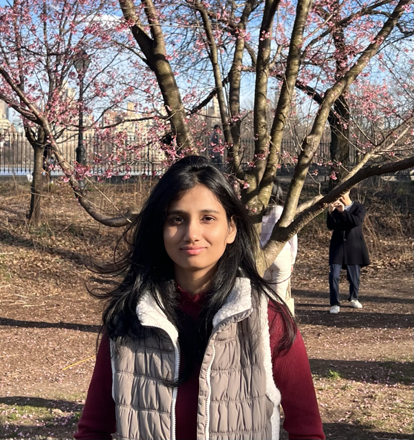

{: style="float: right; margin: 0px 20px; width: 200px; border-radius: 0;" name="fox"}

Hi! I am Divya, a third-year Ph.D. student in Computer Science at Boston University, advised by [Dr. Aaron Mueller](https://aaronmueller.github.io).

My primary interests are in interpretable machine learning. I want to work on problems that involve understanding language and vision models at a fundamental level. Currently, I am studying the geometry of internal representations in language models. I hope that developing a deeper understanding of these models will help us gain insights into the systems we are building and deploying today.

Outside of research, I enjoy reading science fiction and traveling.

If you are interested in my work, would like to  discuss ideas, or have   any questions, please feel free to reach out!

**Email:** [divsp@bu.edu](mailto:divya@bu.edu)

<!--__Blog-course:__    NLP Course For You - look [here](https://lena-voita.github.io/nlp_course.html).-->
<!-- 
## News 
__2025__
* Stay Tuned! -->

